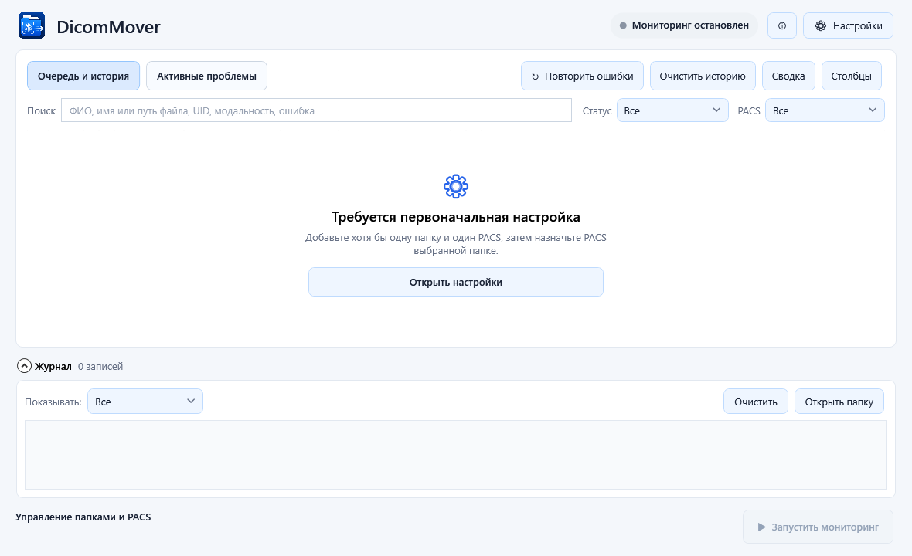

# DicomMover


DicomMover следит за локальными и сетевыми папками Windows и отправляет найденные DICOM-файлы на один или несколько PACS через C-STORE.

Очередь сохраняется после закрытия программы. Если связь с PACS пропадёт, DicomMover дождётся её восстановления и продолжит отправку.

## Пользователю

### Скачать

- [Скачать DicomMover 1.5.5 для Windows x64](https://github.com/Eskimossss/DicomMover/releases/download/1.5.5/DicomMover-1.5.5-win-x64-portable.exe). Программа поставляется одним EXE-файлом и не требует установки.
- [Контрольная сумма SHA-256](https://github.com/Eskimossss/DicomMover/releases/download/1.5.5/SHA256.txt).
- [Все версии и контрольные суммы](https://github.com/Eskimossss/DicomMover/releases).

Сборка работает в Windows 10/11 и Windows Server x64 с графической оболочкой Desktop Experience. Устанавливать .NET Desktop Runtime отдельно не нужно.

### Интерфейс



В главном окне видны очередь, история доставки, активные проблемы, журнал и состояние папок и PACS. Найти запись можно по имени или пути файла, ФИО пациента, UID, модальности и тексту ошибки. Есть фильтры по статусу и PACS. Высоту журнала можно менять мышью.

### Быстрый старт

1. Откройте **Настройки → PACS** и добавьте принимающий сервер.
2. Укажите IP-адрес, порт и Called AE. Поле Calling AE по умолчанию заполняется значением `DICOMMOVER`.
3. Нажмите **Проверить C-ECHO**, чтобы проверить соединение с PACS.
4. Откройте **Настройки → Папки**, добавьте папку с DICOM-файлами и выберите PACS назначения.
5. При необходимости настройте поиск в подпапках, ограничение по Study Date и действие с файлом после успешной отправки.
6. Если старое оборудование записывает кириллицу с неверным или пустым Specific Character Set, откройте **Настройки → Кодировка**, выполните диагностику и проверьте преобразование перед включением правила.
7. Сохраните настройки и нажмите **Запустить мониторинг**.

Для запуска мониторинга нужны хотя бы одна папка и один PACS.

### Основные возможности

- Наблюдение за несколькими папками, включая подпапки. Для каждой папки можно выбрать свои PACS назначения.
- Отбор по Study Date `(0008,0020)` и Study Time `(0008,0030)`. Даты читаются в форматах `yyyyMMdd` и `yyyy.MM.dd`.
- Проверка связи через C-ECHO с отдельным настраиваемым интервалом и отправка через C-STORE. Одинаковые PACS по адресу, порту и Called AE Title добавить нельзя.
- Очередь с сохранением после перезапуска, отдельным результатом для каждого PACS, автоматическими и ручными повторами. Сохранённые исследования можно отправить на дополнительный PACS, не повторяя доставку на остальные.
- Защита от повторной отправки по SOP Instance UID `(0008,0018)`. Для аппаратов с повторяющимися UID есть сравнение файлов по SHA-256 и исправление некорректных SOP/Study/Series Instance UID в отправляемой копии. Исходные файлы и Pixel Data сохраняются.
- Диагностика кодировки и правила для пары «папка → PACS» с условиями по Modality, Station Name и Manufacturer. Для отдельной доставки можно выбрать разовое решение, которое сохраняется до успешного C-STORE.
- Преобразование CP1251-совместимого текста в ISO_IR 144 или ISO_IR 192 без изменения исходного DICOM. Если текст нельзя записать без потерь, преобразование останавливается.
- Сохранение, удаление или архивирование исходных файлов после доставки. Пустые подпапки можно удалять с заданной задержкой.
- Поиск, фильтры, настраиваемые столбцы и подробности DICOM-экземпляра. В активных проблемах видны полный текст ошибки и рекомендуемые действия; в сводке показаны результаты за дату или период с фильтром по PACS.
- Ежедневные журналы, резервные копии базы, автозапуск с Windows и работа в трее. Одновременный запуск двух экземпляров заблокирован.

### Аппараты с некорректными UID и датами

В **Настройки → Папки**, под ограничением даты, есть два независимых переключателя. По умолчанию оба выключены.

- **Игнорировать SOP Instance UID при поиске дубликатов** — сравнивать полное содержимое файлов по SHA-256. Разные снимки с одинаковым исходным UID попадут в очередь отдельно, а точная копия под другим именем повторно не добавится. Если содержимое файла меняется, меняется и отпечаток. Отпечатки успешно отправленных файлов сохраняются после очистки истории.
- **Исправлять некорректные UID перед отправкой** — заменять отсутствующие, некорректные или совпадающие с SOP Class UID идентификаторы снимка, исследования и серии постоянными значениями вида `2.25.*`. Валидные идентификаторы и SOP Class UID сохраняются. При нулевых Study/Series UID каждый файл становится отдельным исследованием и серией; объединение по ФИО или дате рождения не выполняется.

Созданные UID сохраняются при повторных отправках и перезапусках. Режим исправления записывается в очередь, исходный SOP Instance UID остаётся в SQLite. Если после добавления в очередь файл изменился, программа не отправит его с прежними идентификаторами.

При включённом исправлении UID корректные календарные даты DA вида `2026.09.01` также преобразуются в `20260901` в отправляемой копии. Исходные файлы и Pixel Data не изменяются. Фильтр периода умеет читать оба формата независимо от этих переключателей.

Период отправки задаётся там же, в строке «С … До …», по **Study Date (0008,0020)** и **Study Time (0008,0030)**. Например, с `23.11.2026 11:30` до `25.11.2026 08:00`. Обе границы входят в диапазон, секунды принимаются равными нулю.

Нажмите на поле даты, чтобы открыть календарь. Часы (00–23) и минуты (00–59) выбираются из списков, ввод произвольного текста недоступен. Флажок «Указать время» включает ограничение по времени, кнопка «Сбросить» убирает выбранную границу.

Если дата не задана, соответствующей границы нет, а время рядом с ней не учитывается. Если дата задана без времени, для «С» используется начало дня, для «До» конец дня. Программа не позволит сохранить настройки, если начало позже окончания или время некорректно. Снимок без достоверного Study Time проходит фильтр, только если весь день исследования входит в диапазон.

При запуске мониторинга фильтр применяется и к накопленной очереди. Для старых записей Study Time считывается из исходного DICOM; сам файл не меняется.

Кодировка текста настраивается отдельно. Принудительную Windows-1251 выбирайте после проверки исходных байтов. Для корректно объявленной `ISO_IR 144` подходит автоматический режим.

### Если PACS недоступен

При ручном запуске мониторинга DicomMover проверяет доступность включённых папок, базы SQLite и PACS. Если C-ECHO не выполнен, в отчёте будет указан проблемный PACS. После этого можно отменить запуск или продолжить работу с недоступным сервером.

Интервал C-ECHO задаётся отдельно в **Настройки → Мониторинг** и не зависит от интервала сканирования папок. Первая проверка выполняется сразу после запуска мониторинга.

Если PACS недоступен во время работы:

- доставка конкретного DICOM-файла на этот PACS остаётся в очереди;
- проверка соединения повторяется через настроенный интервал;
- счётчик попыток C-STORE не увеличивается;
- после восстановления связи отправка продолжается автоматически.

Если соединение установлено, но C-STORE завершается ошибкой, повторы выполняются через 1, 5, 15 и 30 минут. После пятой ошибки автоматические повторы прекращаются. Доставку можно вернуть в очередь вручную кнопкой **Повторить ошибки** или через подробности выбранного файла.

### Работа с исходными файлами

После успешной доставки файла на все назначенные PACS программа может:

- оставить файл в исходной папке;
- удалить файл;
- перенести файл в архив.

Для архива можно сохранить исходную структуру подпапок. В режимах удаления и архивирования доступна очистка опустевших вложенных папок с задержкой от 5 до 1440 минут; корневая наблюдаемая папка и каталог `BAD` не удаляются. Поле задержки недоступно, пока очистка выключена.

Если файл недоступен, заблокирован или ещё записывается, программа оставит его на месте и проверит в следующем цикле. Если файл перестал меняться, но три проверки подряд подтверждают повреждение, он переносится в каталог `BAD` внутри наблюдаемой папки. Ошибка доступа к одной подпапке не останавливает проверку остальных.

Перед использованием автоматического удаления рекомендуется проверить конфигурацию и отправку на тестовых данных.

### Очередь и защита от повторной отправки

Для каждого DICOM-файла хранится отдельный результат доставки на каждый PACS. Незавершённые доставки остаются в очереди после перезапуска программы.

После успешной отправки SOP Instance UID записывается в отдельный реестр. Поэтому очистка старой подробной истории не приводит к повторной отправке уже доставленного DICOM-экземпляра.

Команда **Очистить историю** скрывает выбранные записи из главного окна. Она не удаляет исходные DICOM-файлы.

### Журнал и персональные данные

Журнал открывается в нижней части главного окна. Записи можно отфильтровать по уровням **Ошибки**, **Предупреждения** и **Информация**.

Если журнал закрыт и появляется новое предупреждение или ошибка, рядом с его заголовком отображается метка **Новая проблема**. Кнопка **Очистить** очищает только видимую область; файл журнала остаётся на диске.

В окне отображаются последние 2 000 строк. Полный журнал записывается в файл.

Запись ФИО пациента в файлы журнала по умолчанию отключена. При этом ФИО сохраняется в локальной базе SQLite для отображения очереди. Учитывайте требования вашей организации к обработке медицинских и персональных данных.

### Активные проблемы

На вкладке **Активные проблемы** показаны недоступные PACS и папки, повреждённые DICOM-файлы в `BAD`, доставки с исчерпанным лимитом попыток и ошибки перекодировки текста.

Двойной щелчок открывает подробности исследования: полный текст последней ошибки и состояние доставки на каждый PACS.

Если кодировка неоднозначна, нажмите **Решить проблему**. Можно выбрать кодировку для одной доставки или создать постоянное правило. Разовое решение сохраняется в SQLite после перезапуска. Проблема закрывается после успешного C-STORE; повторную отправку нужно запустить отдельной командой.

### Диагностика и кодировка DICOM-текста

Правила кодировки задаются для пары **исходная папка → PACS назначения**. Пока правило не создано и не включено, DicomMover отправляет файл без преобразования текста.

Правило можно дополнительно ограничить по Modality `(0008,0060)`, Station Name `(0008,1010)` и Manufacturer `(0008,0070)`. Все выбранные условия выполняются одновременно. Значения можно получить из файлов выбранной папки без загрузки Pixel Data либо ввести вручную. Если одному файлу соответствует несколько правил, используется наиболее специфичное; если подходящего правила нет, исходный DICOM отправляется без преобразования.

Диагностика анализирует ограниченное количество последних файлов, показывает Specific Character Set, исходные байты и варианты чтения текстовых элементов. Проверка преобразования позволяет убедиться, что выбранные поля можно сохранить в целевой кодировке без появления `?` или `�`. Ложное объявление `ISO_IR 100` исправляется только явным правилом или разовым решением инженера.

При применении правила преобразованный DICOM создаётся во временном каталоге `%LOCALAPPDATA%\DicomMover\Temp` и удаляется после попытки C-STORE. Исходный файл в наблюдаемой папке остаётся неизменным, включая Pixel Data. Контрольная проверка временного файла использует `FileReadOption.SkipLargeTags`, поэтому Pixel Data не загружается повторно в память.

### Пропуск дубликатов PACS

В **Настройки → Мониторинг** можно включить **Пропускать дубликаты, отклонённые PACS**. По умолчанию опция выключена.

Если PACS ответил `Duplicate SOP Instance` или явно сообщил в Error Comment о дубликате экземпляра, объекта или исследования, программа завершит доставку без ошибки и повторов. В подробностях появится «Дубликат пропущен», а ответ PACS останется в журнале. В очереди и статистике такая доставка получает статус `Sent`. Сам по себе этот статус не подтверждает приём новых данных.

Исходный файл останется на месте даже при включённом удалении или архивировании. Это правило действует и тогда, когда другие PACS успешно приняли файл.

Ответ `Duplicate Invocation`, отказ без сообщения о дубликате и сетевые ошибки обрабатываются по обычным правилам. Узнать о дубликате можно только из ответа на C-STORE, поэтому первая попытка отправки всё равно нужна.

### Отправка сохранённых исследований

В настройках нужного PACS нажмите **Отправить сохранённые исследования…**. Выберите наблюдаемую папку, диапазон Study Date и Modality. Перед отправкой мастер покажет количество и общий размер доступных файлов. Новые доставки добавляются только для выбранного PACS; существующие не дублируются.

### Перенос настроек

Экспорт настроек сохраняет конфигурацию в JSON-файл. На другом компьютере скачайте актуальную сборку из Releases, импортируйте настройки и проверьте пути к папкам и адреса PACS.

База SQLite, очередь и журналы в экспорт настроек не входят. Если их также требуется перенести, остановите мониторинг и создайте отдельную резервную копию базы.

### Вопросы и предложения

Вопросы, предложения и замечания можно отправить в Telegram: [@eskimossss](https://t.me/eskimossss).

## Разработчикам

Приложение написано на C# и .NET 8 с интерфейсом WPF. Для обмена DICOM используется fo-dicom, очередь хранится в SQLite.

### Архитектура

1. `FolderMonitor` сканирует включённые папки с заданным интервалом.
2. Файл обрабатывается после того, как он перестал изменяться и стал доступен для чтения.
3. После проверки DICOM-метаданных в SQLite создаётся запись файла и отдельная доставка для каждого выбранного PACS.
4. Независимый цикл проверяет PACS через C-ECHO с заданным интервалом; готовая доставка передаётся через C-STORE.
5. Для пары папка → PACS по метаданным без загрузки Pixel Data выбирается наиболее специфичное подходящее правило кодировки.
6. Если правило найдено, преобразованный DICOM записывается во временный файл на диске и передаётся через C-STORE; после отправки временный файл удаляется. Если правило не найдено, отправляется исходный файл. Исходный DICOM в обоих случаях не изменяется.
7. Результат каждой доставки сохраняется независимо. Действие с исходным файлом выполняется только после успешной отправки на все назначенные PACS.

Если сохранить настройки во время работы, DicomMover остановит мониторинг и запустит его заново с новыми параметрами. Отдельный файл конфигурации для фонового процесса при этом не создаётся.

Пауза конкретной папки или PACS хранится только в памяти и действует до перезапуска программы.

### Очередь и повторные отправки

Очередь состоит из DICOM-файлов и связанных с ними доставок. Поэтому один файл может быть уже отправлен на один PACS и продолжать ожидать отправки на другой.

Если PACS или сеть недоступны, следующая проверка доставки назначается примерно через минуту. Попытка C-STORE при этом не расходуется. Отправка начинается, когда PACS отвечает на C-ECHO. Таймаут отдельной операции C-STORE считается ошибкой этой доставки; сам PACS остаётся в состоянии доступности.

Если соединение установлено, но C-STORE завершается ошибкой, счётчик доставки увеличивается:

| Ошибка C-STORE | Следующий автоматический повтор |
|---|---:|
| первая | через 1 минуту |
| вторая | через 5 минут |
| третья | через 15 минут |
| четвёртая | через 30 минут |
| пятая | автоматические повторы прекращаются |

Ручной повтор сбрасывает счётчик неуспешной доставки и возвращает её в очередь. Уже успешно завершённая доставка повторно не создаётся.

Если программа штатно закрывается во время C-STORE, незавершённая доставка возвращается в очередь при следующем запуске без расходования попытки.

### SQLite и срок хранения

Основные таблицы базы:

| Таблица | Содержимое |
|---|---|
| `queue_items` | DICOM-файлы, метаданные и общий статус. |
| `queue_deliveries` | Состояние отправки каждого файла на каждый PACS. |
| `sent_sop_instances` | SOP Instance UID успешно отправленных DICOM-экземпляров. |
| `operational_problems` | Текущие и разрешённые проблемы папок, PACS, файлов и преобразования текста. |
| `rejected_files` | Файлы, подтверждённые как повреждённые и перемещённые в `BAD`. |
| `delivery_encoding_overrides` | Разовые решения кодировки для конкретных доставок. |

Срок хранения истории относится только к подробным записям в SQLite. Исходные DICOM-файлы эта очистка не удаляет.

По истечении срока хранения из `queue_items` удаляются старые успешно завершённые или скрытые записи. UID успешно отправленных экземпляров остаются в `sent_sop_instances`, поэтому такие файлы не добавляются в очередь повторно.

Неуспешная доставка не попадает в реестр отправленных UID. Если скрыть такую запись, дождаться её удаления из SQLite и оставить исходный файл в наблюдаемой папке, он может быть обнаружен снова.

SQLite работает в режиме WAL. При временной блокировке соединение ожидает освобождения базы до 5 секунд вместо немедленной ошибки `database is locked`. Внешние ключи не позволяют оставить доставки без связанной записи файла.

Индексы SQLite ускоряют выборки очереди, доставок, активных проблем и отклонённых файлов по мере роста истории.

При запуске создаётся не более одной резервной копии базы за день. Дополнительная копия создаётся перед важной миграцией схемы. Проверку целостности и оптимизацию SQLite можно включить в настройках.

Экспорт и импорт настроек работают только с конфигурацией JSON. База SQLite, очередь, резервные копии и журналы в этот файл не входят.

### Структура проекта

| Путь | Назначение |
|---|---|
| `Models/` | Настройки, элементы очереди и модели представления. |
| `Services/` | Мониторинг папок, SQLite, журналирование и работа с настройками. |
| `DicomMover.Tests/` | Автоматические тесты xUnit. |
| `Assets/` | Иконка и графические ресурсы приложения. |
| `docs/` | Скриншоты, история изменений и планы развития. |

### Сборка

Требования:

- Windows 10/11;
- .NET 8 SDK;
- Visual Studio 2022 или командная строка .NET.

| Команда | Назначение |
|---|---|
| `dotnet restore` | Загружает зависимости NuGet. |
| `dotnet build DicomMover.csproj` | Собирает приложение. |

### Автоматические тесты

В отдельном проекте `DicomMover.Tests` находятся 236 тестов на xUnit. Они не входят в готовую программу и проверяют настройки, миграции и индексы SQLite, очередь, обработку ошибок C-STORE и восстановление после остановки.

Есть проверки работы с файлами и каталогами, отправки сохранённых исследований, сводки и обработки дубликатов PACS. Тесты кодировки охватывают постоянные правила, разовые решения, условия по DICOM-метаданным и временное преобразование. Отдельно проверяется, что исходный DICOM и Pixel Data не меняются.

```powershell
dotnet test DicomMover.Tests\DicomMover.Tests.csproj
```

### Публикация portable-версии

Следующая команда создаёт автономный EXE для Windows x64:

```powershell
dotnet publish DicomMover.csproj -c Release -r win-x64 --self-contained true `
  -o publish\DicomMover-1.5.5-win-x64-portable `
  -p:PublishSingleFile=true `
  -p:IncludeNativeLibrariesForSelfExtract=true `
  -p:IncludeAllContentForSelfExtract=true `
  -p:DebugType=None `
  -p:DebugSymbols=false `
  -p:EnableCompressionInSingleFile=true
```

Готовый EXE появится в папке `publish\DicomMover-1.5.5-win-x64-portable`. Чтобы разместить сборку на GitHub, добавьте её к нужному Release.

### Версия

Текущая стабильная версия: **1.5.5**. Готовая сборка, инструкция и контрольные суммы опубликованы в [GitHub Release 1.5.5](https://github.com/Eskimossss/DicomMover/releases/tag/1.5.5). Полный список изменений находится в [docs/CHANGELOG.md](docs/CHANGELOG.md).

## Лицензия

Проект распространяется по лицензии [MIT](LICENSE).
